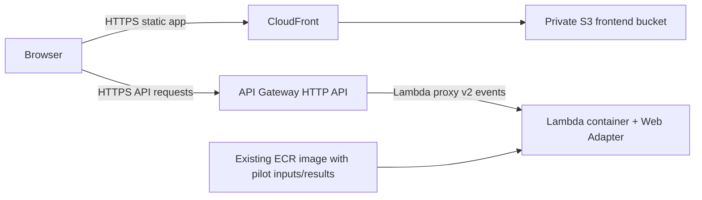

# Phase 6 — serverless AWS deployment (complete for hackathon)

## Current architecture



Region: **Sydney (`ap-southeast-2`)**. CLI profile: `danger-mark-project`. Deployment account: `129762845600`. CloudFront and IAM are global services. ECS/Fargate was abandoned following account `OptInRequired` errors. Do not retry or create EC2, VPC, ECS, Fargate, ALB, NAT Gateway or RDS resources. No application authentication or new product features are introduced.

The existing deployment repository is `129762845600.dkr.ecr.ap-southeast-2.amazonaws.com/danger-mark-api`. Use only this account and repository. The earlier account was incorrect and is no longer a deployment target.

The already-tested local image `danger-mark-api:lambda-phase6` has been pushed and verified in this repository as `lambda-phase6-fe9ecd5`, digest `sha256:92fb38b722181696afe10d00fe85c100fcf54b61e85fc5b77977952d4968dae4`. No application rebuild was needed. The authorized CLI created the logging-only role, Lambda, HTTP API, private frontend S3 bucket and CloudFront distribution in the verified account. Public endpoints and resource IDs are recorded below. Phase 6 browser validation completed on 11 October 2026. No resources were recreated during final validation.

## Container preparation preserved

`backend/Dockerfile` remains the tested base with Python 3.12 and the existing pinned geospatial dependencies. `backend/Dockerfile.lambda` adds the adapter to that image without redownloading dependencies or changing FastAPI code. Linux/amd64 is retained because the pinned Rasterio version did not provide a suitable ARM64 binary wheel.

`infra/lambda_start.py` copies the small saved artifact cache to `/tmp/danger-mark/artifacts`; `/app/artifacts` is a symlink to that writable location. Code and datasets remain read-only. The existing startup validator verifies bundle checksums and loads the saved plans. The data snapshot includes catalog/provenance, processed pilot inputs, the 2.7 KB native population subset and one validated analysis/planning output. No national raster is uploaded or modified. No separate runtime-data S3 bucket is needed.

Adapter settings:

- `AWS_LWA_PORT=8000`
- `AWS_LWA_READINESS_CHECK_PATH=/api/v1/health`
- `AWS_LWA_READINESS_CHECK_HEALTHY_STATUS=200`
- `AWS_LWA_ASYNC_INIT=true`
- `AWS_LWA_ENABLE_COMPRESSION=true`
- `AWS_LWA_INVOKE_MODE=buffered`

Build from the repository root:

```sh
export PATH="/Applications/Docker.app/Contents/Resources/bin:$HOME/.docker/bin:$HOME/.local/bin:$PATH"
docker build --platform linux/amd64 --provenance=false \
  -f backend/Dockerfile.lambda -t danger-mark-api:lambda-phase6 .
```

The local base tag `danger-mark-api:phase6` must be present. A fresh workspace can pull the verified ECR base and tag it locally, or build `backend/Dockerfile` first. `--provenance=false` avoids an attestation image index for Lambda's single-architecture image requirement.

## Verified local results and accepted compression limitation

The Lambda-compatible image passed the ordinary HTTP smoke suite with a read-only filesystem, a 512 MiB `/tmp` tmpfs, 1 CPU and 2 GiB memory: health, demo replay, all analysis GeoJSON, all 12 individual plans, 8 independent backups, null demand/deadlines and CORS.

The official AWS Runtime Interface Emulator then ran the actual Web Adapter against API Gateway HTTP API v2 events. Health, demo, summary, localities, evacuation, safe sites, flood and roads returned JSON identical to direct FastAPI responses when the event contained `Accept-Encoding: gzip`.

Measured road-impact response:

| Measurement | Bytes |
| --- | ---: |
| Decoded FastAPI GeoJSON | 8,159,736 |
| Gzip body from Web Adapter | 498,407 |
| Full Lambda proxy response envelope, including base64 | 664,831 |
| Standard buffered Lambda payload limit | 6,291,456 (6 MiB) |

With no `Accept-Encoding` header, the emulator returned:

```json
{"errorType":"Function.ResponseSizeTooLarge","errorMessage":"Response payload size exceeded maximum allowed payload size (6291556 bytes)."}
```

The error message's reported threshold is quoted verbatim; use the documented 6 MiB limit for deployment design. The emulator enforces the response limit rather than returning the oversized envelope, so there is no successfully captured uncompressed envelope size.

**The user explicitly accepted gzip negotiation as a hackathon deployment requirement.** Clients must advertise `Accept-Encoding: gzip` for the large road-impact response; clients that do not are unsupported for that response. GeoJSON content is unchanged, with no simplification or truncation. API Gateway preservation of `Content-Encoding: gzip` passed the deployed HTTP check; Chrome successfully loaded the full analysis and rendered its road layer. No buffered-response-limit failure occurred on the tested browser path.

The first emulator health event plus comparison completed in approximately 6.4 seconds under local x86 emulation. This is not an AWS cold-start guarantee. API Gateway HTTP API has a 30-second integration timeout; the frontend's existing non-planning reads use a 10-second timeout. The measured deployed cold-start limitation is recorded below. Emulator-reported memory statistics are not a real Lambda memory measurement.

## Reproduce local tests

The emulator binary is cached at ignored `artifacts/deployment/aws-lambda-rie` (downloaded from the official AWS GitHub release). Keep it out of the production image and Git. Do not redownload if present.

Run two containers for the comparator:

```sh
docker run --platform linux/amd64 -d --name danger-mark-lambda-http \
  --read-only --tmpfs /tmp:rw,size=536870912,mode=1777 --cpus 1 --memory 2g \
  -p 127.0.0.1:8002:8000 -e CORS_ORIGINS=http://localhost:8443 \
  danger-mark-api:lambda-phase6

docker run --platform linux/amd64 -d --name danger-mark-lambda-rie \
  --read-only --tmpfs /tmp:rw,size=536870912,mode=1777 --cpus 1 --memory 2g \
  -p 127.0.0.1:9000:8080 \
  -v "$PWD/artifacts/deployment/aws-lambda-rie:/rie:ro" --entrypoint /rie \
  -e CORS_ORIGINS=http://localhost:8443 \
  danger-mark-api:lambda-phase6 python /app/infra/lambda_start.py

scripts/.venv/bin/python infra/smoke.py http://127.0.0.1:8002 http://localhost:8443
scripts/.venv/bin/python infra/lambda_smoke.py
```

`lambda_smoke.py` intentionally fails on the current no-encoding road request, printing the exact emulator error after the successful compressed results. It checks JSON equality, not merely response sizes. Existing stopped test containers should be inspected before creating replacements; do not confuse a duplicate-name error with an application failure.

## Deployed resources and configuration

- Profile/account/region: `danger-mark-project` / `129762845600` / `ap-southeast-2`.
- Frontend: https://dq0ijb66nf6yb.cloudfront.net
- API: https://4pc12p8rt1.execute-api.ap-southeast-2.amazonaws.com
- Health: https://4pc12p8rt1.execute-api.ap-southeast-2.amazonaws.com/api/v1/health
- Lambda: `danger-mark-api`, x86_64, 2,048 MB, 30 seconds, 512 MB ephemeral storage; no VPC or provisioned concurrency.
- Role: `danger-mark-lambda-role`, trusted service Lambda, only `AWSLambdaBasicExecutionRole` attached.
- HTTP API: `4pc12p8rt1`, default stage, proxy payload 2.0, 30-second integration, 10 requests/second and burst 20. Lambda invoke permission is scoped to this API ARN.
- CloudWatch: `/aws/lambda/danger-mark-api`, seven-day retention.
- Private S3: `danger-mark-frontend-129762845600-sydney`; public access blocked, CloudFront-only GetObject policy.
- CloudFront: `E3190UEF4G2T6N`; OAC `E3BREGU4FDD3I9`, SigV4 always; HTTPS redirect, default certificate, gzip, index.html root and SPA fallback.
- API Gateway and Lambda CORS allow only `https://dq0ijb66nf6yb.cloudfront.net`; Content-Encoding is exposed.
- Frontend build VITE_API_BASE_URL is the API origin above. Only compiled frontend assets are in S3; no raw datasets or credentials were uploaded.

Resource IDs are also in `infra/deployment.json`. CloudFront's saved creation configuration is `infra/cloudfront.json`; its scoped bucket policy is `infra/frontend-bucket-policy.json`. Do not rerun create commands for resources that already exist.

## Validation and known limitations

- Docker/Lambda image build and local read-only/RIE tests passed before deployment (same digest reused).
- Public health, synthetic demo summary, analysis summary, flood/localities/roads/safe-sites, aggregate evacuation and all 12 individual plans passed. Twelve primary and eight independent backup routes; demand/capacity/deadlines stay unknown.
- Exact-origin CORS smoke passed. Gzip road response: 498,407 compressed bytes, 8,159,736 decoded bytes. API Gateway preserved Content-Encoding: gzip and decoded JSON exactly equals the complete local Phase 3 result. Decoded SHA256: `13b331aa131514a5b050bdc1766d67487d3e34ea3ba1c9dc7c2b19327789db92`.
- Public CloudFront root and `/evacuation` SPA fallback served the built app. Chrome visibly rendered the synthetic demo dashboard.
- Final Chrome journey passed on 11 October 2026: fresh analysis reload, Command Center, Flood Intelligence, flood/closure-candidate map overlays, locality selection, Evacuation, primary/backup selection, Safe Sites and advisory preview. Janta Garden retained its selection and backup across navigation (primary 0.24 km/~1.9 min; backup 0.56 km/~3.7 min). Tibetan Colony reset to primary on selection and explicitly reported no independent backup when selected. Destinations stayed unverified; capacity/headcount/deadline stayed unknown. No captured application console errors or warnings.
- Browser compression compatibility was verified by successful fresh analysis loading and road-overlay rendering through the unchanged gzip-negotiating adapter. Separate deployed HTTP tests directly verified Content-Encoding: gzip and full content equality. The automation did not capture a raw browser request-header trace; no claim of direct Accept-Encoding header inspection is made.
- Regression: 76 backend/pipeline tests passed (67 + 9); 10 dataset checks passed; 15 frontend tests passed; TypeScript and production build passed. Existing dependency deprecation warnings remain.
- First cold start took ~32.5 seconds (9.83 seconds init + 22.70 seconds invocation) and the API returned HTTP 503 before the app became ready. Subsequent smoke checks passed. Peak observed memory was ~323 MB. This is a startup-latency limitation, not a memory or gzip payload failure. Warm health before presenting; scale-out can still cold-start. No architecture change or always-on warming was introduced.
- Gzip-negotiating clients are required for roads. Uncompressed clients exceed Lambda's buffered response limit. The tested Chrome path successfully rendered roads; clients without gzip remain unsupported for that endpoint.
- Candidate facilities are not verified official shelters; capacity/headcounts/deadlines are not invented. Advisory delivery remains simulated. The analysis is hypothetical and not operationally validated.

## Revalidate or update

From the repository root, with the authenticated profile (no access keys in files):

```sh
export SSL_CERT_FILE="$(scripts/.venv/bin/python -m certifi)"
scripts/.venv/bin/python infra/smoke.py \
  https://4pc12p8rt1.execute-api.ap-southeast-2.amazonaws.com \
  https://dq0ijb66nf6yb.cloudfront.net --require-gzip
```

Use the installed CA bundle on this macOS Python environment; do not disable TLS verification. Build frontend with the VITE_API_BASE_URL from `infra/.env.example`. Upload hashed assets first with long immutable caching, then index.html with no-cache. For updates use S3 sync/cp with `--profile danger-mark-project --region ap-southeast-2`; invalidate CloudFront paths if needed. Update Lambda by verified image digest after local testing; do not overwrite working application logic.

Before a demo, open health and retry if startup returns 503; proceed only after status ok. Select analysis → Janta Garden → primary/backup → Tibetan Colony without backup → Flood Intelligence → Safe Sites → advisory preview. Chrome DevTools Network must show a successful road-impacts request with Accept-Encoding containing gzip and Content-Encoding: gzip; verify overlays and no app console errors.

## Costs and cleanup

Lambda/API Gateway requests, ECR/S3 storage, CloudFront traffic and logs are usage-metered. No VPC, EC2, ECS, Fargate, ALB, NAT, database, WAF or paid provisioned concurrency was created. Account credits/Free-plan coverage are not guaranteed by successful deployment. No billing-plan change was made.

After the hackathon, review resource IDs in `infra/deployment.json`. If authorized to remove deployment, disable then delete CloudFront (wait for deployment), remove its OAC, delete frontend objects/bucket, HTTP API, Lambda, log group, and detach/delete its role. Retain or delete ECR images/repository according to the user's choice. Cleanup is destructive and has not been performed. Never target the old account.

References: [AWS Lambda Web Adapter](https://github.com/aws/aws-lambda-web-adapter), [Lambda image requirements](https://docs.aws.amazon.com/lambda/latest/dg/images-create.html), [Lambda quotas](https://docs.aws.amazon.com/lambda/latest/dg/gettingstarted-limits.html), [CloudFront OAC](https://docs.aws.amazon.com/AmazonCloudFront/latest/DeveloperGuide/private-content-restricting-access-to-s3.html).

## Final scope

Phase 6 is complete for the hackathon with the explicitly retained cold-start limitation. Final validation changed documentation/status only, with no application changes or AWS resource recreation. Earlier regression/build results remain applicable; they were not rerun for documentation-only edits. Stop here; no later phase has been started.
